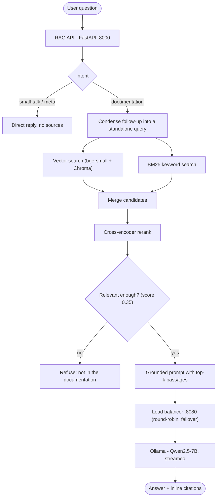
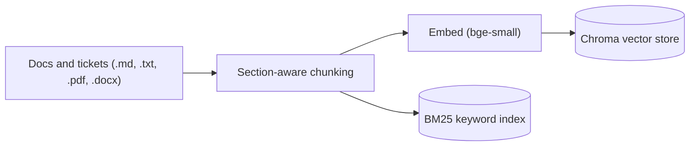

# cbx-rag


A local, fully-free Retrieval-Augmented Generation (RAG) system for CBX /
TradeBeyond documentation and support. Built in Python, runs on a single machine,
no paid APIs.

The system answers natural-language questions **only from your documentation**,
citing the source files — so it can help onboard engineers, assist support
ticket handling, and answer "how does X work in CBX" without hallucinating.

## Features

- **Grounded answers with inline citations** — every fact comes from the indexed
  docs; refuses ("I don't have that in the documentation") when it isn't there.
- **Hybrid retrieval + reranking** — vector (bge-small) + BM25 keyword candidates,
  reordered by a cross-encoder, with a relevance gate.
- **Conversational memory** — follow-ups ("why is that needed?") resolved against
  the conversation, while facts stay strictly grounded.
- **Intent routing** — greetings/small-talk and "what can you do" answered
  naturally (no sources); real questions go through retrieval.
- **Streaming UI** — token-by-token answers, markdown, clickable citations,
  👍/👎 feedback, follow-up suggestions — in a CBX-branded chat.
- **Agent Assist** — paste a support ticket, get a grounded triage draft from
  similar resolved tickets + docs.
- **Ticket connectors** — Jira, Zendesk, Freshservice, and generic REST.
- **Ops** — usage metrics, request logging (PII-redacted), rate limiting, an
  evaluation harness, and CI.

---

## Architecture

A question flows through an intent gate, hybrid retrieval with a relevance gate,
and a load-balanced local LLM. Nothing is answered that isn't grounded in the
retrieved passages.



- **Embedding model:** `BAAI/bge-small-en-v1.5` (Hugging Face, ~130 MB, CPU)
- **Reranker:** `cross-encoder/ms-marco-MiniLM-L-6-v2` (Hugging Face, CPU)
- **Vector store:** Chroma (persistent, local, no server) · **Keyword:** BM25
- **Generation LLM:** `qwen2.5:7b` via Ollama (uses Apple Metal GPU), streamed
- **Load balancer:** custom FastAPI reverse proxy (1 backend today, N-ready)

See [`docs/01-architecture.md`](docs/01-architecture.md) for the full picture.

### Ingestion pipeline

Documents and tickets are chunked section-by-section, embedded, and written to
both the vector store and the keyword index so retrieval can draw on both.



---

## Quick start

```bash
# 1. one-time setup (venv, deps, .env, pull the LLM)
./scripts/setup.sh

# 2. ingest the sample docs first (proves the pipeline)
source .venv/bin/activate
python scripts/ingest_docs.py sample_docs/

# 3. run the test suite (78 tests, no Ollama needed — LLM is mocked)
pip install -r requirements-dev.txt
python -m pytest

# 4. start everything (load balancer + RAG API)
./scripts/run_all.sh

# 5. open the UI:  http://127.0.0.1:8000/   (Chat · Agent Assist · Sources · Metrics)
#    or ask via API:
curl -s http://127.0.0.1:8000/ask \
  -H 'content-type: application/json' \
  -d '{"question": "Why do I get a 401 error?"}' | python3 -m json.tool
```

Once the sample docs work, point ingestion at your own documentation:

```bash
python scripts/ingest_docs.py path/to/your-docs/ --reset
python scripts/ingest_docs.py path/to/another-file.md
```

---

## Project layout

| Path | What it is |
|---|---|
| `config.py` | All settings (env-overridable via `.env`) |
| `app/embeddings.py` | bge-small embedding wrapper |
| `app/ingest.py` | Loading + section-aware chunking (.md/.txt/.pdf/.docx) |
| `app/vectorstore.py` | Chroma add/query/reset |
| `app/retriever.py` | Hybrid (vector + BM25) + cross-encoder rerank + gate |
| `app/rag.py` | Intent routing, condense, grounded answer, agent-assist |
| `app/memory.py` | Per-session conversation memory |
| `app/llm.py` | Ollama chat client (stream + non-stream, via the LB) |
| `app/security.py` | PII detection / redaction |
| `app/telemetry.py` | Request logging + metrics |
| `app/tickets.py` | Ticket → chunk ingestion |
| `app/connectors/` | Jira / Zendesk / Freshservice / generic REST |
| `app/api.py` | HTTP API + chat UI (`app/static/chat.html`) |
| `lb/balancer.py` | The API load balancer |
| `scripts/` | setup, ingest, run-all, evaluate, scan_pii, sync/ingest tickets |
| `eval/` | Scored evaluation cases |
| `tests/` | 78 tests (LLM mocked; no Ollama needed) |
| `docs/` | Full written documentation + changelog |

## API endpoints

| Endpoint | Purpose |
|---|---|
| `GET /` | Chat UI (Chat · Agent Assist · Sources · Metrics) |
| `POST /ask` · `POST /ask/stream` | Grounded answer (JSON / streaming SSE) |
| `POST /search` | Retrieval only (debug recall) |
| `POST /assist` | Agent-assist triage from tickets + docs |
| `POST /feedback` | 👍/👎 logged to `data/feedback.jsonl` |
| `POST /reset` | Clear a conversation session |
| `GET /metrics` | Usage aggregates |
| `GET /connectors` · `POST /connectors/{name}/sync` | Ticket connectors |
| `GET /health` | Liveness + indexed chunk count |

---

## Evaluation & monitoring

A scripted harness (`scripts/evaluate.py`) runs a fixed question set through the
**real** retriever and LLM and scores answer pass rate, refusal accuracy,
retrieval recall, and answer-keyword coverage — run it before and after changes
to catch regressions. Every request is logged (`data/requests.jsonl`) with
intent, sources, top retrieval score, latency, and whether it refused; the UI's
👍/👎 feedback writes to `data/feedback.jsonl` and drives content improvements.

Full methodology, current results, and honest limitations are in
[`docs/08-evaluation.md`](docs/08-evaluation.md).

---

## Documentation

- [`docs/01-architecture.md`](docs/01-architecture.md) — components and data flow
- [`docs/02-setup.md`](docs/02-setup.md) — install & run, step by step
- [`docs/03-how-rag-works.md`](docs/03-how-rag-works.md) — RAG explained
- [`docs/04-load-balancer.md`](docs/04-load-balancer.md) — how the LB works & how to scale
- [`docs/05-cbx-data.md`](docs/05-cbx-data.md) — moving from sample docs to your data
- [`docs/06-conversation-memory.md`](docs/06-conversation-memory.md) — multi-turn memory + strict grounding
- [`docs/07-tickets.md`](docs/07-tickets.md) — support tickets + agent-assist
- [`docs/08-evaluation.md`](docs/08-evaluation.md) — evaluation, monitoring & limitations
- [`docs/CHANGELOG.md`](docs/CHANGELOG.md) — what changed, when
