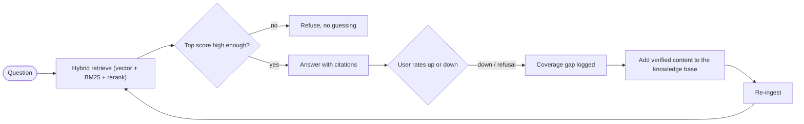

# Evaluation, monitoring & current scope

This document explains how the assistant is tested, how it's monitored in use,
how weak retrieval and wrong answers are prevented, and — honestly — what the
current results do and don't prove.

## How it's evaluated

A scripted evaluation harness (`scripts/evaluate.py`, backed by `eval/cases.json`)
runs a fixed question set through the **real** retriever and LLM — not mocks — and
scores four things:

- **Answer pass rate** — did the answer meet its grounding + refusal expectation?
- **Refusal accuracy** — are out-of-scope questions correctly declined?
- **Retrieval recall** — for cases with a declared gold source, was it retrieved?
- **Answer-keyword coverage** — do in-scope answers contain the required facts?

It runs before and after changes to catch regressions in retrieval, grounding, or
answer quality. The unit/integration suite (78 tests) runs in CI on every push.

```bash
# needs Ollama running
python scripts/evaluate.py              # uses eval/cases.json
python scripts/evaluate.py my_cases.json
# writes data/eval_results.json
```

## Results (current eval set)

| Metric | Result | What it means |
|---|---|---|
| Pass rate | **11 / 11** | Every case met its grounding + refusal expectations |
| Refusal accuracy | **1.0** | All 3 out-of-scope questions (e.g. "capital of France") were correctly declined |
| Retrieval recall | **1.0** | On the cases with a declared gold source, the expected document was retrieved |
| Answer-keyword coverage | **1.0** | In-scope answers contained the required facts |

## Monitoring in use

Every request is logged to `data/requests.jsonl` with intent, sources, top
retrieval score, latency, and whether it refused. Over the requests logged so far:

| Signal | Value |
|---|---|
| Requests logged | 57 (29 documentation, 28 small-talk — intent routing) |
| Refusal rate | 18% (out-of-scope or no confident match) |
| Latency | median 670 ms · p95 ~9.9 s (bound by the local 7B model) |
| Top match score (answered) | median 0.73 |

`GET /metrics` exposes live aggregates, and a 👍/👎 control on every answer writes
to `data/feedback.jsonl`.

## How weak retrieval and wrong answers are prevented



- A **relevance gate** (minimum vector similarity 0.35) makes the assistant refuse
  rather than guess when nothing good is retrieved.
- **Hybrid retrieval + cross-encoder reranking** keeps the most relevant passage in
  the top-k: BM25 catches exact terms embeddings miss; the reranker reorders.
- **Inline citations** make every answer traceable to its source chunk.
- The **feedback loop** turns 👎 and refusals into a coverage signal — they flag
  missing topics, which are added to the knowledge base (verified content only) and
  re-ingested, so gaps close over time instead of becoming hallucinations.

## Current scope (read this before quoting the numbers)

These results are **real but early-stage**, and should be read as "the pipeline
behaves correctly," not "validated at production scale":

- The eval set is **11 cases** and the telemetry/feedback are from early dev use
  (**57 requests, 8 ratings**). Small samples — enough to prove correctness, not breadth.
- Feedback is **anonymous** 👍/👎 by session; it is **not attributed** to a specific
  reviewer or team, so it shouldn't be cited as formal external sign-off.
- Retrieval recall is measured **only on cases that declare a gold source**; other
  cases assert answer content rather than a specific document.
- Latency at p95 reflects a **local 7B model on one machine**, not a hosting limit.

## Roadmap to harden it

- Expand the eval set to cover every module, each with labelled gold sources.
- Add ranking metrics (hit@k, MRR) alongside the current pass/refusal scores.
- Run a structured review round with **named testers** so feedback is attributable.
- Move generation to a hosted LLM endpoint to bring p95 latency down for a shared
  deployment.
